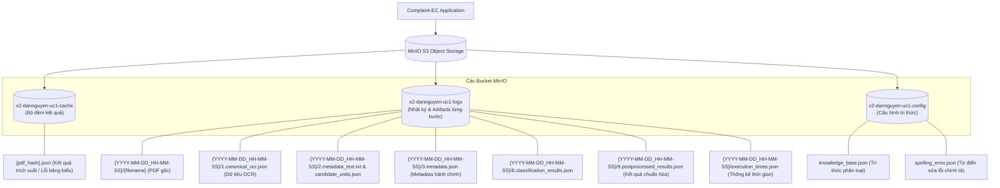
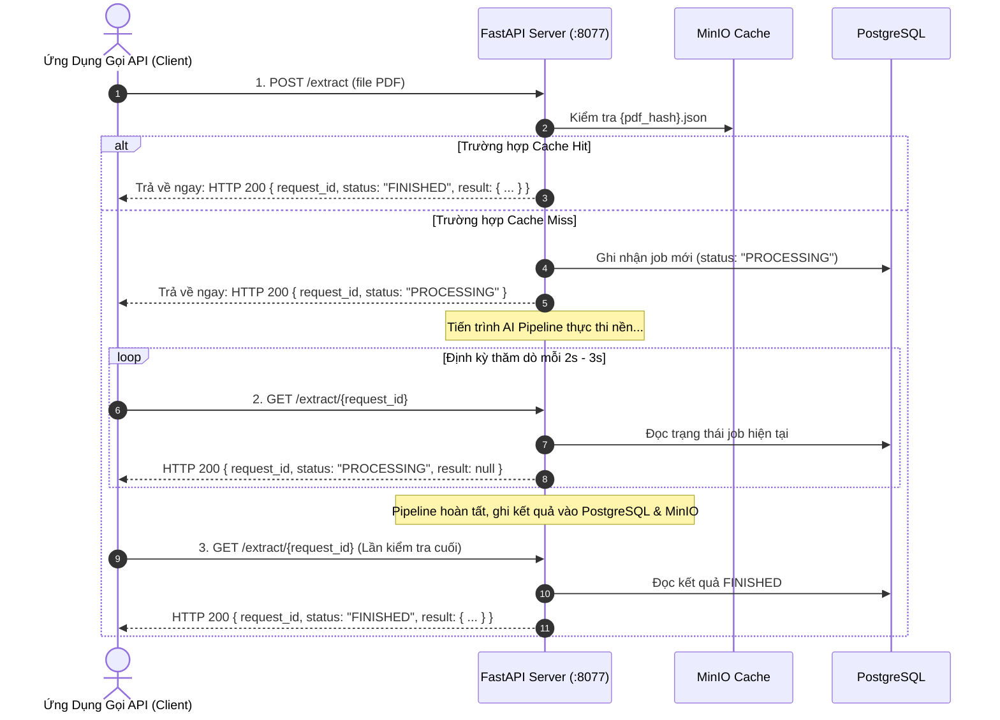
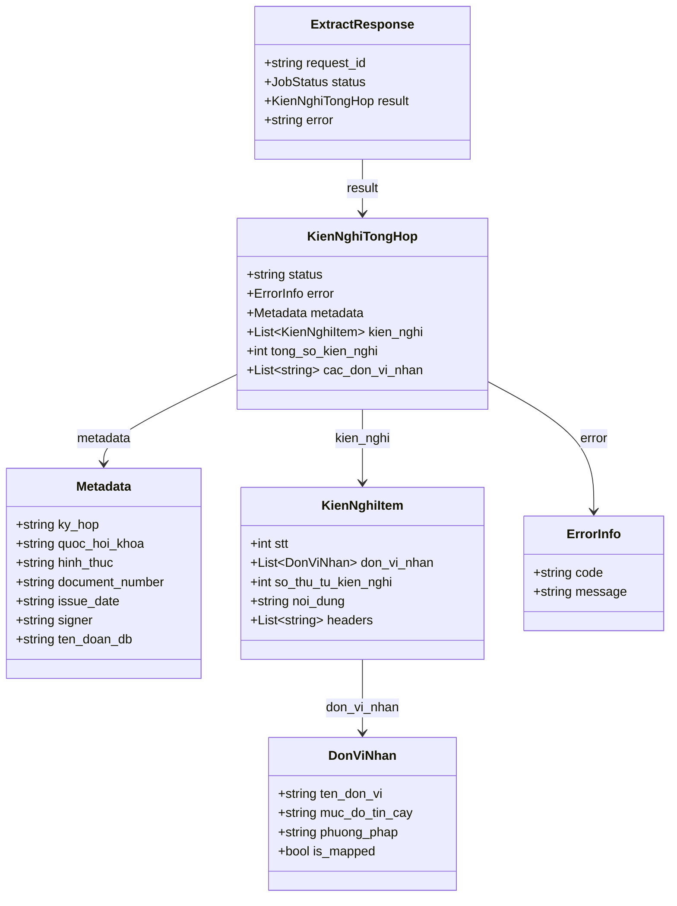

# TÀI LIỆU KỸ THUẬT VÀ ĐẶC TẢ GIAO DIỆN LẬP TRÌNH ỨNG DỤNG (API SPECIFICATION)
## HỆ THỐNG TRÍCH XUẤT VÀ PHÂN LOẠI KIẾN NGHỊ CỬ TRI (COMPLAINT-EC)

* **Phiên bản tài liệu**: `1.0.0`
* **Tiêu chuẩn thiết kế**: RESTful API, OpenAPI 3.0.3 / JSON Schema draft 2020-12
* **Framework**: FastAPI (Python 3.10) / Pydantic V2
* **Môi trường phục vụ**: Docker Container (`complaint-ec-app`)
* **Mục đích tài liệu**: Cung cấp đặc tả chi tiết giao diện API, cơ chế tiếp nhận dữ liệu đầu vào, quy trình lưu trữ kết quả trên MinIO và cấu trúc dữ liệu chuẩn phục vụ công tác tích hợp và đánh giá an toàn thông tin (ATTT).

---

## MỤC LỤC
1. [Tổng Quan Hệ Thống](#1-tổng-quan-hệ-thống)
2. [Cơ Chế Tiếp Nhận Dữ Liệu (File PDF) & Lưu Kết Quả Vào MinIO](#2-cơ-chế-tiếp-nhận-dữ-liệu-file-pdf--lưu-kết-quả-vào-minio)
   * 2.1. Quy trình tiếp nhận & tiền kiểm tra file PDF
   * 2.2. Cơ chế Khử trùng lặp (Single-Flight Request Coalescing) & Bộ đệm (Cache)
   * 2.3. Cơ chế phân vùng & lưu trữ dữ liệu vào MinIO Object Storage
3. [Phương Thức Tích Hợp Hệ Thống (Polling Định Kỳ)](#3-phương-thức-tích-hợp-hệ-thống-polling-định-kỳ)
4. [Đặc Tả Chi Tiết Các Endpoint API](#4-đặc-tả-chi-tiết-các-endpoint-api)
   * 4.1. `POST /extract` - Upload file PDF & Khởi tạo trích xuất
   * 4.2. `GET /extract/{request_id}` - Polling kiểm tra trạng thái & lấy kết quả
   * 4.3. `GET /health` - Kiểm tra tình trạng dịch vụ (Liveness Probe)
   * 4.4. `GET /health/celery` - Kiểm tra cụm điều phối Celery & Worker Queues
5. [Đặc Tả Cấu Trúc Dữ Liệu (Data Schemas)](#5-đặc-tả-cấu-trúc-dữ-liệu-data-schemas)
   * 5.1. Sơ đồ cấu trúc đối tượng (Class Diagram)
   * 5.2. Chi tiết các trường dữ liệu
6. [Bảng Mã Trạng Thái HTTP & Mã Lỗi Nghiệp Vụ](#6-bảng-mã-trạng-thái-http--mã-lỗi-nghiệp-vụ)

---

## 1. TỔNG QUAN HỆ THỐNG

Hệ thống **Complaint-EC** cung cấp nền tảng xử lý dữ liệu hành chính tự động phục vụ công tác tổng hợp kiến nghị cử tri:
* **Đầu vào**: Công văn, báo cáo tổng hợp kiến nghị cử tri định dạng PDF.
* **Quy trình xử lý**:
  1. Tiếp nhận file PDF, tính mã băm (Hash) và kiểm tra bộ đệm kết quả.
  2. OCR bóc tách cấu trúc cây văn bản (Canonical OCR Tree), tự động cắt tỉa footnotes, header/footer artifacts và phát hiện bảng biểu.
  3. Bóc tách thông tin hành chính công văn (Metadata: kỳ họp, khóa Quốc hội, ngày ban hành, người ký, tên Đoàn ĐBQH...).
  4. Tách đoạn và phân lập các kiến nghị độc lập (Candidate Units).
  5. Phân loại và dự đoán cơ quan thẩm quyền giải quyết (Top 1–5 cơ quan theo danh mục chuẩn) bằng thuật toán so khớp mờ (Rapidfuzz) kết hợp Mô hình ngôn ngữ lớn (LLM).
  6. Hậu xử lý chuẩn hóa tên cơ quan, tự động bổ sung cơ quan mặc định ("Bộ Nội Vụ", "Văn Phòng Chính Phủ"), làm sạch văn bản và đánh số thứ tự liên tục.

### Thông tin kết nối cơ bản:
* **Base URL**: `http://localhost:8077` (hoặc domain/IP triển khai thực tế)
* **Swagger UI Documentation**: `http://localhost:8077/docs`
* **OpenAPI Specification**: `http://localhost:8077/openapi.json`
* **Định dạng dữ liệu mặc định**: `application/json; charset=utf-8` (riêng endpoint tải tài liệu sử dụng `multipart/form-data`).
* **Custom Response Headers**: Mọi HTTP response từ hệ thống đều được Middleware tự động đính kèm header `X-Process-Time` (ví dụ: `0.0125s`) đo đạc tổng thời gian máy chủ xử lý yêu cầu.

---

## 2. CƠ CHẾ TIẾP NHẬN DỮ LIỆU (FILE PDF) & LƯU KẾT QUẢ VÀO MINIO

Hệ thống vận hành xử lý dữ liệu hoàn toàn trên bộ nhớ đệm (In-memory) và lưu trữ phân tán, đảm bảo tính trung thực theo đúng mã nguồn triển khai:

### 2.1. Quy trình tiếp nhận & tiền kiểm tra file PDF
Khi client gửi yêu cầu đến endpoint `POST /extract`:
1. **Kiểm tra định dạng Content-Type ([app.py](app.py))**:
   * Hệ thống kiểm tra header `file.content_type`. Chỉ chấp nhận duy nhất giá trị `application/pdf` (`ALLOWED_CONTENT_TYPES`).
   * Nếu gửi sai định dạng (ví dụ: ảnh, docx, file nén), hệ thống ngắt xử lý ngay lập tức và trả về mã lỗi `HTTP 415 Unsupported Media Type`.
2. **Đọc dữ liệu và kiểm soát kích thước file ([app.py](app.py))**:
   * File được đọc bất đồng bộ vào bộ nhớ RAM dưới dạng chuỗi byte (`pdf_bytes = await file.read()`). Hệ thống **không ghi file tạm ra đĩa cứng cục bộ** tại bước tiếp nhận.
   * Kích thước byte được kiểm tra qua ngưỡng `MAX_PDF_SIZE_BYTES` (**30MB = 30 * 1024 * 1024 bytes**). Nếu vượt quá giới hạn, hệ thống trả về mã lỗi `HTTP 413 Payload Too Large`.
3. **Tính toán hàm băm dữ liệu (Data Hash)**:
   * Hệ thống sinh mã băm từ mảng byte của file PDF thông qua hàm `file_hash` ([modules/pipeline.py](modules/pipeline.py)) sử dụng thuật toán `Blake3` (nếu có thư viện) hoặc `SHA-256`. Mã hash này đóng vai trò là khóa định danh duy nhất (Unique Fingerprint) của nội dung tài liệu.

### 2.2. Cơ chế Khử trùng lặp (Single-Flight Request Coalescing) & Bộ đệm (Cache)
Nhằm ngăn chặn hiện tượng lãng phí tài nguyên và nghẽn GPU/VRAM khi nhiều request cùng upload một file PDF:
1. **Kiểm tra Cache trên MinIO**:
   * Khi `force_reprocess = false` (mặc định), hệ thống kiểm tra file `{pdf_hash}.json` trong bucket cache của MinIO (`MINIO_CACHE_BUCKET = x2-dannguyen-uc1-cache`).
   * **Cache Hit**: Nếu file đã tồn tại, hệ thống đọc dữ liệu JSON, tự động thẩm định và lọc bỏ các kiến nghị chung (nếu có), tạo bản ghi job trong PostgreSQL với trạng thái `FINISHED`, và trả về ngay kết quả từ bộ đệm mà không cần kích hoạt lại AI Pipeline.
2. **Điều phối Single-Flight ([SingleFlightManager trong app.py](app.py))**:
   * Nếu **Cache Miss** hoặc `force_reprocess = true`, request được đưa vào bộ điều phối `SingleFlightManager`:
     * **LEADER**: Request đầu tiên tiếp nhận mã hash sẽ giữ vai trò Leader, trực tiếp kích hoạt AI Pipeline xử lý.
     * **FOLLOWER**: Các request gửi cùng mã hash trong khi Leader đang xử lý sẽ trở thành Follower, lắng nghe sự kiện đồng bộ `asyncio.Event` từ Leader với thời gian chờ tối đa 600 giây (`FOLLOWER_TIMEOUT_SECONDS`). Khi Leader hoàn thành, tất cả Follower lập tức nhận kết quả chung mà không gọi lại AI Pipeline.
3. **Khởi tạo trạng thái trong Database**:
   * Hệ thống sinh mã `request_id` dạng UUID v4 và lưu bản ghi vào bảng `request_logs` thuộc schema `x2_dannguyen_u1` trên PostgreSQL với trạng thái `PROCESSING`.
4. **Phân phối tác vụ nền (Background Processing)**:
   * Tác vụ được chuyển vào `BackgroundTasks` của FastAPI.
   * Module [modules/celery_health.py](modules/celery_health.py) kiểm tra tình trạng RabbitMQ Broker, Redis Backend và 8 Celery Worker Queues:
     * Nếu cụm Celery sẵn sàng: Đẩy tác vụ vào hàng đợi Celery theo cơ chế Round-Robin (`x2.dannguyen.uc1.worker1_queue` → `worker8_queue`).
     * Nếu Celery gặp sự cố: Tự động chuyển sang chế độ **In-process Fallback**, chạy pipeline trực tiếp trong tiến trình của FastAPI, đảm bảo không làm gián đoạn việc phục vụ.

### 2.3. Cơ chế phân vùng & lưu trữ dữ liệu vào MinIO Object Storage
Hệ thống sử dụng MinIO S3 Object Storage ([modules/minio_utils.py](modules/minio_utils.py)) với 3 bucket được phân tách rành mạch:



1. **Bucket Cache (`x2-dannguyen-uc1-cache`)**:
   * Lưu trữ kết quả trích xuất hoàn chỉnh dưới tên file là mã băm nội dung: `{pdf_hash}.json`.
   * Trường hợp tài liệu chứa bảng biểu không được hỗ trợ, kết quả lỗi có cấu trúc (`TABLE_CONTENT_UNSUPPORTED`) cũng được lưu vào cache để tránh xử lý lại khi upload trùng file.
2. **Bucket Nhật Ký & Dữ Liệu Trung Gian (`x2-dannguyen-uc1-logs`)**:
   * Mỗi phiên xử lý được gán một mốc thời gian GMT+7: `{YYYY-MM-DD_HH-MM-SS}`. Khi ghi vào bucket logs, hàm `normalize_minio_key()` ([modules/minio_utils.py](modules/minio_utils.py)) tự động chuẩn hóa loại bỏ tiền tố `logs/`, do đó các object bên trong bucket `x2-dannguyen-uc1-logs` có tiền tố trực tiếp là `{YYYY-MM-DD_HH-MM-SS}/`.
   * Toàn bộ thao tác ghi file vào bucket logs được chuyển vào **`ThreadPoolExecutor(max_workers=4)`** chạy nền bất đồng bộ (`fire-and-forget`), không làm chậm luồng phản hồi API.
   * Các tệp tin được lưu lại gồm:
     * File PDF gốc: `{YYYY-MM-DD_HH-MM-SS}/{filename}` (`application/pdf`).
     * `{YYYY-MM-DD_HH-MM-SS}/1.canonical_ocr.json`: Cấu trúc cây OCR dạng Canonical JSON nhận từ OCR service.
     * `{YYYY-MM-DD_HH-MM-SS}/2.metadata_text.txt`: Phần văn bản bóc tách từ Header và Footer phục vụ trích xuất metadata.
     * `{YYYY-MM-DD_HH-MM-SS}/2.candidate_units.json`: Danh sách các khối kiến nghị kèm đường dẫn breadcrumbs tiêu đề.
     * `{YYYY-MM-DD_HH-MM-SS}/3.metadata.json`: Kết quả trích xuất 8 trường thông tin hành chính công văn.
     * `{YYYY-MM-DD_HH-MM-SS}/6.classification_results.json`: Kết quả phân loại thẩm quyền trước khi chuẩn hóa.
     * `{YYYY-MM-DD_HH-MM-SS}/9.postprocessed_results.json`: Kết quả cuối cùng sau khi chuẩn hóa tên cơ quan theo danh mục và đánh số lại STT.
     * `{YYYY-MM-DD_HH-MM-SS}/execution_times.json`: Thống kê thời gian xử lý chi tiết của từng bước trong pipeline.
3. **Bucket Cấu Hình Tri Thức (`x2-dannguyen-uc1-config`)**:
   * Lưu trữ 2 tệp cấu hình phục vụ AI: `knowledge_base.json` (cơ sở tri thức phân loại kiến nghị) và `spelling_error.json` (từ điển sửa lỗi OCR).
   * Khi khởi động ứng dụng ([entrypoint.sh](entrypoint.sh)), hệ thống tự động kiểm tra và đồng bộ hai file này lên MinIO nếu chưa tồn tại.

---

## 3. PHƯƠNG THỨC TÍCH HỢP HỆ THỐNG (POLLING ĐỊNH KỲ)

Trên môi trường triển khai thực tế (Production), hệ thống áp dụng **phương thức Polling định kỳ** (Asynchronous Polling Pattern). Đây là phương thức an toàn, phù hợp với mọi kiến trúc mạng nội bộ, máy chủ nằm sau NAT hoặc tường lửa:



### Các bước tích hợp:
1. **Bước 1**: Client gửi tài liệu PDF qua `POST /extract`.
2. **Bước 2**: Server phản hồi ngay HTTP 200 với mã `request_id` và trạng thái `"PROCESSING"`.
3. **Bước 3**: Client gửi request `GET /extract/{request_id}` định kỳ sau mỗi **2 đến 3 giây**.
4. **Bước 4**: Khi trường `status` chuyển thành `"FINISHED"`, kết quả chi tiết trích xuất nằm tại trường `result`. Nếu xảy ra lỗi, trường `status` chuyển thành `"FAILED"` kèm thông điệp tại `error`.

---

## 4. ĐẶC TẢ CHI TIẾT CÁC ENDPOINT API

---

### 4.1. Upload File PDF & Khởi Tạo Trích Xuất

* **HTTP Method**: `POST`
* **Path**: `/extract`
* **Content-Type**: `multipart/form-data`
* **Mô tả nghiệp vụ**: Tiếp nhận công văn kiến nghị cử tri định dạng PDF, kiểm tra tính hợp lệ của file, kiểm tra cache và đưa tác vụ vào hàng đợi xử lý bất đồng bộ.

#### Tham số Đầu vào (Form Data):
| Tên tham số | Kiểu dữ liệu | Bắt buộc | Vị trí | Ràng buộc kỹ thuật | Ý nghĩa |
| :--- | :--- | :--- | :--- | :--- | :--- |
| `file` | `binary` | **Bắt buộc** | Form-Data | Định dạng: `application/pdf`<br>Dung lượng: $\le$ **30MB** | File PDF công văn báo cáo tổng hợp kiến nghị cử tri. |
| `force_reprocess` | `boolean` | Không | Form-Data | `true` hoặc `false` (Mặc định: `false`) | Nếu `true`, ép buộc hệ thống chạy lại AI Pipeline bỏ qua bộ đệm Cache. |

#### Phản hồi Thành công - Tiếp nhận xử lý bất đồng bộ (HTTP `200 OK`):
*(Do route cấu hình `response_model_exclude_unset=True`, các trường `result` và `error` khi chưa khởi tạo sẽ tự động được loại trừ khỏi payload trả về)*:
```json
{
  "request_id": "c7a812ef-29b1-4b16-9ef0-0a568b209d84",
  "status": "PROCESSING"
}
```

#### Phản hồi Thành công - Trả về ngay từ Cache Hit (HTTP `200 OK`):
```json
{
  "request_id": "c7a812ef-29b1-4b16-9ef0-0a568b209d84",
  "status": "FINISHED",
  "result": {
    "status": "success",
    "error": null,
    "metadata": {
      "ky_hop": "Kỳ họp thứ 7",
      "quoc_hoi_khoa": "XV",
      "hinh_thuc": "Trước kỳ họp",
      "document_number": "145/ĐĐB-VP",
      "issue_date": "10/05/2024",
      "signer": "Nguyễn Văn B",
      "ten_doan_db": "Đoàn Đại biểu Quốc hội tỉnh Quảng Ninh"
    },
    "kien_nghi": [
      {
        "stt": 1,
        "don_vi_nhan": [
          {
            "ten_don_vi": "Bộ Xây dựng",
            "muc_do_tin_cay": "high",
            "phuong_phap": "rule_based",
            "is_mapped": true
          },
          {
            "ten_don_vi": "Bộ Nội Vụ",
            "muc_do_tin_cay": "low",
            "phuong_phap": "llm",
            "is_mapped": false
          },
          {
            "ten_don_vi": "Văn Phòng Chính Phủ",
            "muc_do_tin_cay": "low",
            "phuong_phap": "llm",
            "is_mapped": false
          }
        ],
        "so_thu_tu_kien_nghi": 1,
        "noi_dung": "Cử tri kiến nghị Bộ Xây dựng sớm đầu tư nâng cấp tuyến Quốc lộ 18A đoạn qua địa bàn thị xã Đông Triều nhằm đảm bảo an toàn giao thông cho người dân.",
        "headers": [
          "I. KIẾN NGHỊ VỀ GIAO THÔNG VẬN TẢI"
        ]
      }
    ],
    "tong_so_kien_nghi": 1,
    "cac_don_vi_nhan": [
      "Bộ Xây dựng",
      "Bộ Nội Vụ",
      "Văn Phòng Chính Phủ"
    ]
  }
}
```

#### Phản hồi Lỗi Kiểm Soát:
* **HTTP `413 Payload Too Large`** (Dung lượng file vượt quá 30MB):
  ```json
  {
    "detail": "File vượt quá kích thước cho phép (30MB)"
  }
  ```
* **HTTP `415 Unsupported Media Type`** (File không đúng định dạng `application/pdf`):
  ```json
  {
    "detail": "Chỉ chấp nhận file PDF (application/pdf), nhận được: image/jpeg"
  }
  ```

#### Lệnh cURL Mẫu:
```bash
curl -X POST "http://localhost:8077/extract" \
  -H "Accept: application/json" \
  -F "file=@cong_van_quang_ninh.pdf;type=application/pdf" \
  -F "force_reprocess=false"
```

---

### 4.2. Polling Kiểm Tra Trạng Thái & Lấy Kết Quả

* **HTTP Method**: `GET`
* **Path**: `/extract/{request_id}`
* **Mô tả nghiệp vụ**: Client định kỳ gọi endpoint này để kiểm tra tiến độ xử lý của `request_id` và lấy dữ liệu kết quả khi hoàn tất.

#### Tham số Đường dẫn (Path Parameters):
| Tên tham số | Kiểu dữ liệu | Bắt buộc | Ràng buộc | Ý nghĩa |
| :--- | :--- | :--- | :--- | :--- |
| `request_id` | `string` | **Bắt buộc** | Định dạng UUID chuẩn (36 ký tự) | Mã định danh tác vụ nhận được từ endpoint `/extract`. |

#### Phản hồi khi tác vụ đang xử lý (HTTP `200 OK`):
```json
{
  "request_id": "c7a812ef-29b1-4b16-9ef0-0a568b209d84",
  "status": "PROCESSING",
  "result": null,
  "error": null
}
```

#### Phản hồi khi hoàn thành thành công (HTTP `200 OK`):
Trả về đối tượng `ExtractResponse` có `status: "FINISHED"` và `result` chứa dữ liệu chi tiết theo chuẩn (chi tiết tại mục [5. Đặc Tả Dữ Liệu](#5-đặc-tả-cấu-trúc-dữ-liệu-data-schemas)).

#### Phản hồi khi tài liệu chứa bảng biểu không hỗ trợ (HTTP `200 OK`):
```json
{
  "request_id": "c7a812ef-29b1-4b16-9ef0-0a568b209d84",
  "status": "FINISHED",
  "result": {
    "status": "failed",
    "error": {
      "code": "TABLE_CONTENT_UNSUPPORTED",
      "message": "File PDF chứa bảng biểu (table), hiện tại hệ thống chưa hỗ trợ trích xuất dữ liệu từ bảng."
    },
    "metadata": {
      "ky_hop": null,
      "quoc_hoi_khoa": null,
      "hinh_thuc": null,
      "document_number": null,
      "issue_date": null,
      "signer": null,
      "ten_doan_db": null
    },
    "kien_nghi": [],
    "tong_so_kien_nghi": 0,
    "cac_don_vi_nhan": []
  },
  "error": null
}
```

#### Phản hồi khi tác vụ thất bại (HTTP `200 OK`):
```json
{
  "request_id": "c7a812ef-29b1-4b16-9ef0-0a568b209d84",
  "status": "FAILED",
  "result": null,
  "error": "Lỗi xử lý: Kết nối dịch vụ OCR bị timeout sau 300s"
}
```

#### Phản hồi Lỗi (HTTP `404 Not Found`):
```json
{
  "detail": "request_id not found"
}
```

#### Lệnh cURL Mẫu:
```bash
curl -X GET "http://localhost:8077/extract/c7a812ef-29b1-4b16-9ef0-0a568b209d84" \
  -H "Accept: application/json"
```

---

### 4.3. Kiểm Tra Tình Trạng Dịch Vụ (Liveness Probe)

* **HTTP Method**: `GET`
* **Path**: `/health`
* **Mô tả**: Sử dụng cho Docker Healthcheck và Kubernetes Liveness Probe để xác nhận FastAPI container đang phản hồi bình thường.

#### Phản hồi (HTTP `200 OK`):
```json
{
  "status": "ok"
}
```

---

### 4.4. Kiểm Tra Cụm Điều Phối Celery & Worker Queues

* **HTTP Method**: `GET`
* **Path**: `/health/celery`
* **Mô tả**: Giám sát trực tiếp kết nối AMQP tới RabbitMQ Broker, kết nối tới Redis Result Backend và Ping cụm 8 worker queues (`x2.dannguyen.uc1.worker*_queue`).
* **Tham số Query**: `force_check` (`boolean`, mặc định `false`, nếu `true` ép kiểm tra trực tiếp bỏ qua bộ nhớ đệm trạng thái 5s).

#### Phản hồi khi bình thường (HTTP `200 OK`):
```json
{
  "celery_active": true,
  "detail": "Celery và 8 pipeline workers đang hoạt động bình thường",
  "mode": "celery_distributed"
}
```

#### Phản hồi khi Broker / Worker gián đoạn (Tự động chuyển Fallback):
```json
{
  "celery_active": false,
  "detail": "Không có Celery worker nào thuộc hàng đợi pipeline (x2.dannguyen.uc1.worker*_queue) phản hồi",
  "mode": "in_process_fallback"
}
```

---

## 5. ĐẶC TẢ CẤU TRÚC DỮ LIỆU (DATA SCHEMAS)

Toàn bộ phản hồi dữ liệu của hệ thống được quản lý qua Pydantic V2 Models tuân thủ nghiêm ngặt theo JSON Schema draft 2020-12 ([docs/schema_2608.json](docs/schema_2608.json)) với cấu hình `extra="forbid"` (`additionalProperties: false`):

### 5.1. Sơ Đồ Cấu Trúc Đối Tượng (Class Diagram)



---

### 5.2. Chi Tiết Các Trường Dữ Liệu

#### 1. `ExtractResponse` (Đối Tượng Bao Ngoài Quản Lý Vòng Đời Yêu Cầu)
| Tên trường | Kiểu dữ liệu | Bắt buộc | Ràng buộc / Giá trị cho phép | Ý nghĩa |
| :--- | :--- | :--- | :--- | :--- |
| `request_id` | `string` | **Có** | Định dạng chuỗi UUID | Mã định danh duy nhất của tác vụ. |
| `status` | `string` | **Có** | Enum: `["PROCESSING", "FINISHED", "FAILED"]` | Trạng thái vòng đời xử lý của tác vụ. |
| `result` | `object \| null` | Không | Đối tượng `KienNghiTongHop` | Dữ liệu nghiệp vụ chi tiết (có khi `FINISHED`). |
| `error` | `string \| null` | Không | Chuỗi mô tả lỗi | Thông báo nguyên nhân lỗi (nếu `FAILED`). |

#### 2. `KienNghiTongHop` (Dữ Liệu Nghiệp Vụ Trích Xuất Chính)
| Tên trường | Kiểu dữ liệu | Bắt buộc | Ràng buộc Schema | Ý nghĩa |
| :--- | :--- | :--- | :--- | :--- |
| `status` | `string \| null` | Không | Enum: `["success", "failed"]` | Trạng thái thực thi của AI Pipeline. |
| `error` | `object \| null` | Không | Đối tượng `ErrorInfo` | Chi tiết lỗi nếu không thể bóc tách tài liệu. |
| `metadata` | `object` | **Có** | Đối tượng `Metadata` | Thông tin hành chính của công văn. |
| `kien_nghi` | `array` | **Có** | Mảng các đối tượng `KienNghiItem` | Danh sách các kiến nghị bóc tách được. |
| `tong_so_kien_nghi`| `integer` | **Có** | `minimum: 0`<br>**Bắt buộc bằng len(kien_nghi)** | Tổng số lượng kiến nghị trong tài liệu. |
| `cac_don_vi_nhan` | `array of str` | **Có** | `uniqueItems: true` (Không trùng lặp) | Danh sách tên duy nhất của toàn bộ cơ quan xuất hiện trong kết quả. |

#### 3. `Metadata` (Thông Tin Hành Chính Công Văn)
*Bắt buộc phải có mặt toàn bộ các key trong JSON (cho phép giá trị nhận `null` nếu tài liệu không đề cập)*:
| Tên trường | Kiểu dữ liệu | Giá trị mẫu | Mô tả |
| :--- | :--- | :--- | :--- |
| `ky_hop` | `string \| null` | `"Kỳ họp thứ 7"` | Kỳ họp Quốc hội được tổ chức tiếp xúc. |
| `quoc_hoi_khoa` | `string \| null` | `"XV"` | Khóa Quốc hội (số La Mã hoặc chữ số). |
| `hinh_thuc` | `string \| null` | `"Trước kỳ họp"` / `"Sau kỳ họp"` | Thời điểm tổng hợp ý kiến cử tri. |
| `document_number` | `string \| null` | `"145/ĐĐB-VP"` | Số hiệu công văn/báo cáo chính thức. |
| `issue_date` | `string \| null` | `"10/05/2024"` | Ngày ban hành văn bản. |
| `signer` | `string \| null` | `"Nguyễn Văn B"` | Người ký phát hành công văn/báo cáo. |
| `ten_doan_db` | `string \| null` | `"Đoàn Đại biểu Quốc hội tỉnh Quảng Ninh"` | Tên Đoàn ĐBQH ban hành công văn. |

#### 4. `KienNghiItem` (Một Kiến Nghị Độc Lập)
| Tên trường | Kiểu dữ liệu | Bắt buộc | Ràng buộc | Ý nghĩa |
| :--- | :--- | :--- | :--- | :--- |
| `stt` | `integer` | **Có** | `minimum: 1` | Số thứ tự tăng dần liên tục trong toàn bộ tài liệu (1..N). |
| `don_vi_nhan` | `array` | **Có** | `minItems: 1, maxItems: 5` | Top 1–5 cơ quan thẩm quyền dự đoán (xếp theo độ phù hợp giảm dần). |
| `so_thu_tu_kien_nghi` | `integer` | **Có** | `minimum: 1` | Số thứ tự kiến nghị trong cơ quan thẩm quyền chính (`don_vi_nhan[0]`). |
| `noi_dung` | `string` | **Có** | `minLength: 1` | Nội dung kiến nghị đã được làm sạch, nối dòng hoàn chỉnh. |
| `headers` | `array of str` | **Có** | Danh sách chuỗi | Các cấp tiêu đề/đề mục chứa kiến nghị này. |

#### 5. `DonViNhan` (Đơn Vị Thẩm Quyền Được Đề Xuất)
| Tên trường | Kiểu dữ liệu | Bắt buộc | Ràng buộc | Ý nghĩa |
| :--- | :--- | :--- | :--- | :--- |
| `ten_don_vi` | `string` | **Có** | `minLength: 1` | Tên cơ quan thẩm quyền đã chuẩn hóa. |
| `muc_do_tin_cay` | `string` | **Có** | Enum: `["high", "medium", "low"]` | Độ tin cậy của thuật toán dự đoán. |
| `phuong_phap` | `string` | **Có** | Chuỗi (ví dụ: `rule_based`, `llm`, `hybrid`) | Phương pháp đưa ra dự đoán. |
| `is_mapped` | `boolean \| null` | Không | `true` hoặc `false` | `true` nếu khớp từ tiêu đề; `false` nếu do LLM suy luận. |

#### 6. `ErrorInfo` (Thông Tin Lỗi Nghiệp Vụ)
| Tên trường | Kiểu dữ liệu | Bắt buộc | Ràng buộc | Ý nghĩa |
| :--- | :--- | :--- | :--- | :--- |
| `code` | `string` | **Có** | `enum: ["TABLE_CONTENT_UNSUPPORTED"]` | Mã định danh lỗi nghiệp vụ. |
| `message` | `string` | **Có** | Chuỗi thông báo | Thông tin giải thích nguyên nhân lỗi. |

---

## 6. BẢNG MÃ TRẠNG THÁI HTTP & MÃ LỖI NGHIỆP VỤ

### 6.1. Bảng Mã HTTP Status Code Chuẩn

| HTTP Code | Trạng thái chuẩn | Ý nghĩa trong hệ thống Complaint-EC | Hướng dẫn xử lý cho Client |
| :--- | :--- | :--- | :--- |
| **`200 OK`** | Success | Yêu cầu được tiếp nhận hoặc xử lý thành công. Kiểm tra trường `status` trong body (`PROCESSING`, `FINISHED`, `FAILED`). | Đọc nội dung JSON phản hồi. |
| **`400 Bad Request`** | Client Error | Dữ liệu đầu vào hoặc định dạng yêu cầu không hợp lệ. | Kiểm tra lại dữ liệu và tham số gửi lên. |
| **`404 Not Found`** | Not Found | `request_id` không tồn tại trong cơ sở dữ liệu. | Kiểm tra lại tính chính xác của mã UUID. |
| **`413 Payload Too Large`** | Limit Exceeded | File PDF vượt quá dung lượng cho phép (**30MB**). | Nén hoặc giảm dung lượng tài liệu trước khi gửi. |
| **`415 Unsupported Media Type`** | Invalid Format | File không đúng định dạng MIME `application/pdf`. | Đảm bảo tải lên file PDF chuẩn. |
| **`500 Internal Server Error`** | Server Error | Lỗi hệ thống nội bộ không xác định. | Kiểm tra log máy chủ hoặc liên hệ quản trị viên. |

### 6.2. Mã Lỗi Nghiệp Vụ Trong Response Body
Khi HTTP Status trả về `200 OK` nhưng tài liệu không thể trích xuất do đặc thù cấu trúc:

| Mã lỗi (`error.code`) | HTTP Status | Nguyên nhân | Cấu trúc phản hồi mẫu |
| :--- | :--- | :--- | :--- |
| **`TABLE_CONTENT_UNSUPPORTED`** | `200 OK` | File PDF chứa dữ liệu dạng bảng biểu (`tables > 0`). Hệ thống hiện chuyên sâu xử lý văn bản dạng đề mục và đoạn văn. | `result.status = "failed"`<br>`result.error.code = "TABLE_CONTENT_UNSUPPORTED"`<br>`result.kien_nghi = []`<br>`result.tong_so_kien_nghi = 0` |
