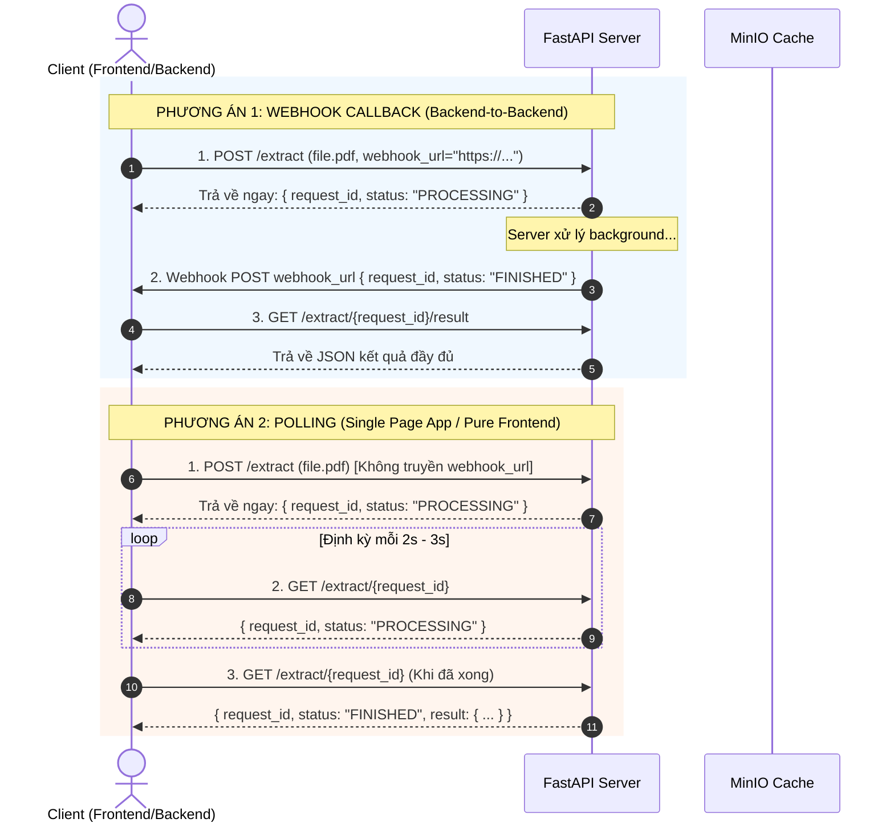

# Tài Liệu Kỹ Thuật API: Trích Xuất & Phân Loại Kiến Nghị Cử Tri

Phiên bản: `1.0.0`  
Content-Type mặc định: `application/json` (riêng `POST /extract` nhận `multipart/form-data`)

---

## 1. Tổng Quan

Hệ thống cung cấp API tiếp nhận công văn PDF chứa kiến nghị cử tri, tự động:
1. Trích xuất **metadata hành chính** (kỳ họp, khóa Quốc hội, hình thức, số công văn, ngày ban hành, người ký, tên Đoàn ĐBQH).
2. Tách và làm sạch danh sách **nội dung kiến nghị cử tri**.
3. Phân loại và dự đoán **Cơ quan thẩm quyền giải quyết** (Top 1–5 cơ quan, độ tin cậy `high`/`medium`/`low`, phương pháp `rule_based`/`llm`).

Quá trình xử lý chạy **bất đồng bộ (asynchronous background processing)** kết hợp **cache thông minh** trên MinIO theo mã hash của file PDF.

---

## 2. Phương Án Tích Hợp Cho Client

Client lựa chọn 1 trong 2 phương án tùy theo kiến trúc:



### Phương án 1: Webhook Callback
* **Phù hợp với**: Backend-to-Backend hoặc Client có Webhook receiver công khai.
* **Quy trình**:
  1. Client gửi `POST /extract` kèm file PDF và `webhook_url`.
  2. Server phản hồi ngay `{ "request_id": "...", "status": "PROCESSING" }`.
  3. Khi xử lý xong, Server gửi HTTP POST tới `webhook_url` với payload:
     ```json
     {
       "request_id": "c7a812ef-29b1-4b16-9ef0-0a568b209d84",
       "status": "FINISHED"
     }
     ```
     *(Server tự động retry tối đa 3 lần với exponential backoff nếu webhook timeout hoặc trả về HTTP >= 400).*
  4. Client nhận webhook và gọi `GET /extract/{request_id}/result` để lấy toàn bộ dữ liệu kết quả.

### Phương án 2: Polling Trạng Thái
* **Phù hợp với**: Client Frontend thuần (React, Vue, Flutter, Mobile) không có domain/IP public.
* **Quy trình**:
  1. Client gửi `POST /extract` chứa file PDF (**không** gửi `webhook_url`).
  2. Server phản hồi ngay `{ "request_id": "...", "status": "PROCESSING" }`.
  3. Client gọi `GET /extract/{request_id}` định kỳ mỗi 2–3 giây.
  4. Khi `status` chuyển thành `FINISHED`, response trả kèm luôn object `result` chứa đầy đủ dữ liệu.

> **Cơ chế Cache**: Khi upload file trùng lặp (cùng mã hash) với `force_reprocess=false`, Server trả về ngay `FINISHED` cùng toàn bộ kết quả trong vài mili-giây mà không cần chạy lại AI Pipeline.

---

## 3. Chi Tiết Các Endpoint

### 3.1. Upload File & Khởi Tạo Trích Xuất
* **URL**: `/extract`
* **Method**: `POST`
* **Content-Type**: `multipart/form-data`

#### Parameters (Form Data):
| Tên tham số | Kiểu | Bắt buộc | Mô tả |
| :--- | :--- | :--- | :--- |
| `file` | Binary | **Có** | File PDF công văn (tối đa **30MB**, định dạng `application/pdf`). |
| `webhook_url` | String | Không | URL Webhook Callback nhận thông báo khi hoàn thành. |
| `force_reprocess` | Boolean | Không | Mặc định `false`. Nếu `true`, ép buộc chạy lại AI Pipeline bỏ qua Cache. |

#### cURL Ví dụ:
```bash
# Phương án 1 (Có webhook)
curl -X POST "http://localhost:8077/extract" \
  -F "file=@cong_van.pdf;type=application/pdf" \
  -F "webhook_url=https://client.com/webhook"

# Phương án 2 (Polling)
curl -X POST "http://localhost:8077/extract" \
  -F "file=@cong_van.pdf;type=application/pdf"
```

#### Phản hồi (200 OK - Đang xử lý):
```json
{
  "request_id": "c7a812ef-29b1-4b16-9ef0-0a568b209d84",
  "status": "PROCESSING"
}
```

#### Phản hồi (200 OK - Cache Hit):
```json
{
  "request_id": "c7a812ef-29b1-4b16-9ef0-0a568b209d84",
  "status": "FINISHED",
  "result": {
    "status": "success",
    "metadata": {
      "ky_hop": "Kỳ họp thứ 9",
      "quoc_hoi_khoa": "XV",
      "hinh_thuc": "Trước kỳ họp",
      "document_number": "123/ĐĐB-VP",
      "issue_date": "15/05/2024",
      "signer": "Nguyễn Văn A",
      "ten_doan_db": "Đoàn Đại biểu Quốc hội tỉnh Quảng Ninh"
    },
    "kien_nghi": [
      {
        "stt": 1,
        "don_vi_nhan": [
          {
            "ten_don_vi": "Bộ Xây dựng",
            "muc_do_tin_cay": "high",
            "phuong_phap": "rule_based",
            "is_mapped": true
          },
          {
            "ten_don_vi": "Bộ Nội Vụ",
            "muc_do_tin_cay": "low",
            "phuong_phap": "llm",
            "is_mapped": false
          },
          {
            "ten_don_vi": "Văn Phòng Chính Phủ",
            "muc_do_tin_cay": "low",
            "phuong_phap": "llm",
            "is_mapped": false
          }
        ],
        "so_thu_tu_kien_nghi": 1,
        "noi_dung": "Cử tri kiến nghị sớm nâng cấp tuyến Quốc lộ 18A...",
        "headers": ["I. LĨNH VỰC GIAO THÔNG VẬN TẢI"]
      }
    ],
    "tong_so_kien_nghi": 1,
    "cac_don_vi_nhan": [
      "Bộ Xây dựng",
      "Bộ Nội Vụ",
      "Văn Phòng Chính Phủ"
    ]
  }
}
```

---

### 3.2. Polling Trạng Thái & Lấy Kết Quả
* **URL**: `/extract/{request_id}`
* **Method**: `GET`

#### Phản hồi khi hoàn tất (200 OK):
Trả về object `ExtractResponse` gồm `request_id`, `status: "FINISHED"` và `result` (`KienNghiTongHop`).

#### Phản hồi khi lỗi (200 OK):
```json
{
  "request_id": "c7a812ef-29b1-4b16-9ef0-0a568b209d84",
  "status": "FAILED",
  "error": "Lỗi xử lý: ..."
}
```

---

### 3.3. Lấy Kết Quả Chi Tiết (Dành Cho Webhook)
* **URL**: `/extract/{request_id}/result`
* **Method**: `GET`
* Client gọi sau khi nhận được Webhook báo `FINISHED`.

---

### 3.4. Phân Loại Kiến Nghị Độc Lập
Phân loại thẩm quyền cho nội dung phản ánh kiến nghị trực tiếp từ chuỗi text mà không cần upload PDF.

* **URL**: `/classify_complaint`
* **Method**: `POST` (hỗ trợ cả `GET` với query `?text=...`)
* **Content-Type**: `application/json`, `application/x-www-form-urlencoded`, hoặc `multipart/form-data`

#### Request Body (JSON):
```json
{
  "text": "Cử tri kiến nghị Bộ Giao thông vận tải sớm đầu tư nâng cấp mở rộng Quốc lộ 1A để đảm bảo an toàn giao thông."
}
```

#### Phản hồi (200 OK):
Trả về đối tượng chuẩn `ExtractResponse` có cấu trúc hoàn toàn đồng nhất với `/extract/{request_id}/result`.

---

### 3.5. Kiểm Tra Tình Trạng Hệ Thống
* **GET `/health`**: Trả về `{"status": "ok"}`.
* **GET `/health/celery`**: Kiểm tra trạng thái chi tiết của RabbitMQ Broker, Redis Backend và các Celery Workers:
```json
{
  "celery_active": true,
  "detail": "Celery và 8 pipeline workers đang hoạt động bình thường",
  "mode": "celery_distributed"
}
```

---

## 4. Xử Lý Lỗi (Error Handling)

| HTTP Code | Trạng thái | Nguyên nhân & Hướng xử lý |
| :--- | :--- | :--- |
| **`200 OK`** | Thành công | Yêu cầu được tiếp nhận. Kiểm tra trường `status` (`PROCESSING`, `FINISHED`, `FAILED`). |
| **`400 Bad Request`** | Thiếu dữ liệu | Nội dung text hoặc dữ liệu input để trống. |
| **`404 Not Found`** | Không tìm thấy | `request_id` không tồn tại trong hệ thống. |
| **`413 Payload Too Large`** | File quá lớn | Dung lượng file PDF vượt quá giới hạn cho phép (30MB). |
| **`415 Unsupported Media Type`** | Sai định dạng | File không thuộc định dạng `application/pdf`. |
| **`500 Internal Server Error`** | Lỗi hệ thống | Sự cố nội bộ trong quá trình xử lý. |

> **Lỗi Bảng Biểu (`TABLE_CONTENT_UNSUPPORTED`)**:  
> Nếu tài liệu PDF chứa bảng biểu (table), hệ thống sẽ trả về response có `status: "failed"` và mã lỗi `TABLE_CONTENT_UNSUPPORTED` theo đúng schema:
> ```json
> {
>   "status": "failed",
>   "error": {
>     "code": "TABLE_CONTENT_UNSUPPORTED",
>     "message": "Tài liệu PDF chứa bảng biểu (table), hiện tại hệ thống chưa hỗ trợ trích xuất dữ liệu từ bảng."
>   },
>   "metadata": { ... },
>   "kien_nghi": [],
>   "tong_so_kien_nghi": 0,
>   "cac_don_vi_nhan": []
> }
> ```
