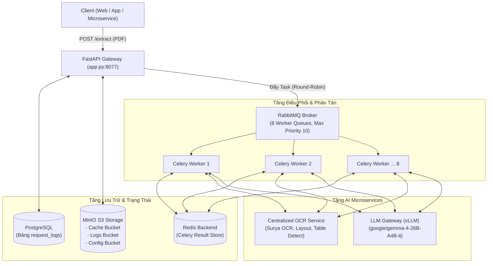

# Kiến Trúc Hệ Thống & AI Pipeline: Complaint-EC

Tài liệu mô tả chi tiết kiến trúc tổng thể, hạ tầng phân tán, cơ chế xử lý đồng thời và các giai đoạn của AI Pipeline trong hệ thống Complaint-EC.

---

## 1. Sơ Đồ Kiến Trúc Tổng Thể

---

## 2. Các Thành Phần Hạ Tầng (Infrastructure Components)

1. **FastAPI Web Service (`app.py`)**:
   - Cung cấp API bất đồng bộ (port `8077`).
   - Quản lý vòng đời request, lưu trữ trạng thái vào PostgreSQL connection pool (`psycopg2.pool.ThreadedConnectionPool`).
   - Điều phối **Single-Flight Coalescing** và kiểm tra cache trước khi đẩy việc cho worker.
2. **RabbitMQ Broker**:
   - Broker vận chuyển tin nhắn cho Celery, hỗ trợ thuộc tính ưu tiên `max_priority: 10`.
   - Phân chia thành 8 hàng đợi chuyên biệt (`x2.dannguyen.uc1.worker1_queue` → `x2.dannguyen.uc1.worker8_queue`).
3. **Redis Result Backend**:
   - Lưu trữ kết quả tác vụ Celery với tiền tố `x2:dannguyen:uc1:`.
   - Cơ chế polling thread-safe qua `task_result.ready()`.
4. **PostgreSQL**:
   - Schema: `x2_dannguyen_u1`, bảng `request_logs`.
   - Lưu trữ `request_id`, `status` (`PROCESSING`, `FINISHED`, `FAILED`), kết quả trích xuất `result` (JSONB) và `webhook_url`.
5. **MinIO Object Storage**:
   - `x2-dannguyen-uc1-cache`: Cache kết quả trích xuất dạng `{pdf_hash}.json`.
   - `x2-dannguyen-uc1-logs`: Lưu toàn bộ log và artifacts của từng request (PDF gốc, các file JSON/TXT của từng bước).
   - `x2-dannguyen-uc1-config`: Lưu cấu hình tri thức `knowledge_base.json` và từ điển sửa lỗi chính tả `spelling_error.json`.
6. **Centralized OCR Service**:
   - Trích xuất văn bản từ PDF sang `Canonical OCR Tree` dạng JSON cấu trúc phân cấp (loại bỏ footers/footnotes).
   - Phát hiện bảng biểu tự động.
7. **LLM Gateway (vLLM)**:
   - Phục vụ mô hình `google/gemma-4-26B-A4B-it` (OpenAI-compatible endpoint).

---

## 3. Cơ Chế Tối Ưu Hóa Hiệu Năng & Chịu Tải

### 3.1. Single-Flight Request Coalescing
Nhằm ngăn chặn hiện tượng **Thundering Herd** (nhiều request cùng upload một file PDF chưa có cache tại cùng một thời điểm), [`SingleFlightManager`](file:///home/hieunq10/X2-Project/Complaint-EC/app.py#L388-L454) phân phối:
* **LEADER**: Request đầu tiên tiếp nhận file sẽ khởi chạy AI Pipeline và ghi cache vào MinIO khi hoàn tất.
* **FOLLOWER**: Các request gửi cùng mã hash trong khi Leader đang xử lý sẽ trở thành Follower, lắng nghe sự kiện `asyncio.Event` từ Leader mà không gọi lại AI Pipeline, tránh gây nghẽn VRAM và GPU.

### 3.2. Chẩn Đoán Sức Khỏe Celery & Fallback Tự Động
Mỗi khi tiếp nhận request hoặc chạy pipeline, module [`modules/celery_health.py`](file:///home/hieunq10/X2-Project/Complaint-EC/modules/celery_health.py) kiểm tra:
1. Kết nối RabbitMQ Broker.
2. Kết nối Redis Result Backend.
3. Ping các Celery Worker queues.

Nếu một trong các thành phần gặp sự cố hoặc timeout, hệ thống **tự động chuyển sang chế độ In-process Python** (chạy trực tiếp trong process của FastAPI) thay vì đẩy vào queue, đảm bảo API không bị treo hoặc chết tác vụ.

---

## 4. Chi Tiết 4 Giai Đoạn AI Pipeline

### Giai đoạn 1: OCR & Phát hiện Bảng biểu (`modules/pdf_extractor.py`)
* File PDF được gửi tới dịch vụ OCR tập trung.
* Nếu phát hiện bảng biểu (`tables > 0`), hệ thống chủ động dừng xử lý và trả về mã lỗi chuẩn `TABLE_CONTENT_UNSUPPORTED` (hiện tại hệ thống tập trung xử lý văn bản kiến nghị dạng đề mục / đoạn văn).
* Nhận cấu trúc cây Canonical OCR JSON, tự động đệ quy cắt tỉa các node `footnote`, `page_header`, `page_footer`.

### Giai đoạn 2: Parse Cây Văn Bản & Nhóm Đoạn (`modules/tree_parser.py`)
* Duyệt cây phân cấp Canonical OCR:
  * Nhận diện và bóc tách vùng Metadata Header (Quốc hiệu, Tiêu ngữ, Tên cơ quan, Số công văn...) và Footer (Nơi nhận, Người ký...) thành `metadata_text`.
  * Thân bài được bóc tách thành các khối `CandidateUnit`, giữ nguyên đường dẫn cây tiêu đề (`breadcrumbs`).
  * Nhận diện ranh giới phân tách kiến nghị bằng Regex (`BOUNDARY_RE`: số thứ tự `1.1`, `2.`, bullet `-`, `+`, `•`, từ khóa `Cử tri kiến nghị...`).

### Giai đoạn 3: Trích xuất Song song qua LLM
Hai tác vụ chạy song song qua `asyncio.gather`:
* **Trích xuất Metadata ([`modules/metadata_extractor.py`](file:///home/hieunq10/X2-Project/Complaint-EC/modules/metadata_extractor.py))**:
  * Sử dụng prompt trích xuất thông tin hành chính từ `metadata_text`: kỳ họp, khóa Quốc hội, hình thức (trước/sau kỳ họp), số công văn, ngày ban hành, người ký, tên Đoàn ĐBQH.
* **Bóc tách kiến nghị & Phân loại thẩm quyền ([`modules/complaint_classifier.py`](file:///home/hieunq10/X2-Project/Complaint-EC/modules/complaint_classifier.py))**:
  * Gom các `CandidateUnit` thành từng batch gửi tới LLM.
  * Kết hợp thuật toán so khớp mờ `FuzzyClassifier` (Rapidfuzz) trên breadcrumbs với mô hình LLM để xác định các cơ quan có thẩm quyền giải quyết.

### Giai đoạn 4: Hậu xử lý & Chuẩn hóa ([`modules/postprocessor.py`](file:///home/hieunq10/X2-Project/Complaint-EC/modules/postprocessor.py))
* **Chuẩn hóa tên cơ quan**: So khớp và chuẩn hóa tên cơ quan theo danh sách 32 cơ quan trong [`modules/CQTQ.txt`](file:///home/hieunq10/X2-Project/Complaint-EC/modules/CQTQ.txt).
* **Tự động bổ sung cơ quan mặc định**: Kiểm tra và tự động chèn `"Bộ Nội Vụ"` và `"Văn Phòng Chính Phủ"` vào danh sách `don_vi_nhan` nếu chưa xuất hiện.
* **Lọc bỏ kiến nghị chung**: Loại bỏ các kiến nghị có tiêu đề thuộc nhóm "kiến nghị chung" hoặc "tình hình chung" không thuộc thẩm quyền cụ thể (`should_exclude_by_headers`).
* **Làm sạch nội dung**: Nối các câu ngắt dòng giữa chừng, bỏ ký tự markdown và tiền tố số thừa bằng regex hoặc LLM Prompting (`clean_complaints_parallel_llm`).
* **Đánh lại chỉ mục**: Cập nhật lại `stt` liên tục từ 1..N và `so_thu_tu_kien_nghi` theo cơ quan thẩm quyền chính.
