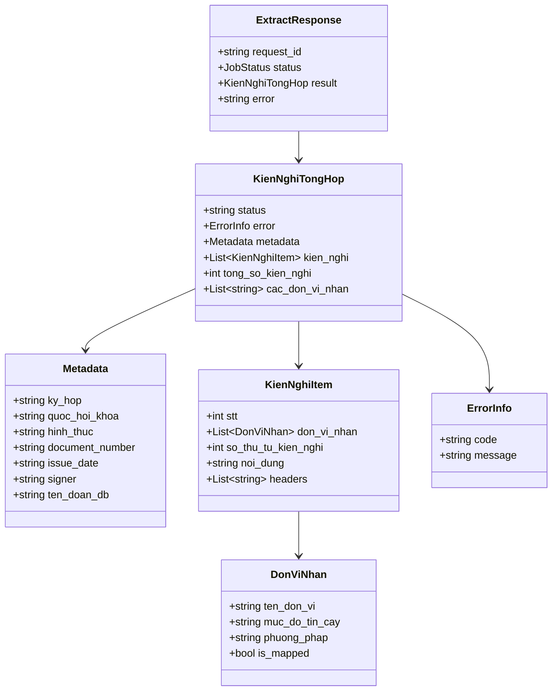

# Đặc Tả Chuẩn Dữ Liệu (Data Schema): Complaint-EC

Phiên bản Schema: `draft 2020-12`  
Tuân thủ: Strict Validation (`additionalProperties: false` trên toàn bộ các object, bắt buộc theo chuẩn Pydantic V2 `extra="forbid"`).

---

## 1. Cấu Trúc Tổng Thể

Dữ liệu trả về từ API gồm 2 lớp chính:
1. **`ExtractResponse`**: Lớp bao ngoài quản lý vòng đời yêu cầu (`request_id`, `status`, `result`, `error`).
2. **`KienNghiTongHop`**: Lớp dữ liệu nghiệp vụ chính nằm trong trường `result`.

---

## 2. Chi Tiết Các Trường Dữ Liệu

### 2.1. `Metadata` (Thông Tin Hành Chính Công Văn)
Các trường bắt buộc phải có mặt trong JSON, cho phép giá trị `null` nếu không tìm thấy trong tài liệu:

| Trường | Kiểu | Mô tả | Ví dụ |
| :--- | :--- | :--- | :--- |
| `ky_hop` | `string \| null` | Kỳ họp Quốc hội | `"Kỳ họp thứ 9"` |
| `quoc_hoi_khoa` | `string \| null` | Khóa Quốc hội | `"XV"` |
| `hinh_thuc` | `string \| null` | Thời điểm tiếp xúc cử tri | `"Trước kỳ họp"` hoặc `"Sau kỳ họp"` |
| `document_number` | `string \| null` | Số hiệu công văn/báo cáo | `"123/ĐĐB-VP"` |
| `issue_date` | `string \| null` | Ngày ban hành văn bản | `"15/05/2024"` |
| `signer` | `string \| null` | Người ký văn bản | `"Nguyễn Văn A"` |
| `ten_doan_db` | `string \| null` | Tên Đoàn đại biểu Quốc hội | `"Đoàn Đại biểu Quốc hội tỉnh Quảng Ninh"` |

---

### 2.2. `DonViNhan` (Cơ Quan Thẩm Quyền Được Đề Xuất)
Mỗi kiến nghị có từ 1 đến 5 ứng viên cơ quan thẩm quyền, sắp xếp theo mức độ phù hợp giảm dần:

| Trường | Kiểu | Ràng buộc | Mô tả |
| :--- | :--- | :--- | :--- |
| `ten_don_vi` | `string` | minLength: 1 | Tên cơ quan thẩm quyền (đã được chuẩn hóa theo danh mục đóng 32 cơ quan). |
| `muc_do_tin_cay` | `string` | enum: `["high", "medium", "low"]` | Mức độ tin cậy của kết quả dự đoán. |
| `phuong_phap` | `string` | minLength: 1 | Mã phương pháp xác định: `rule_based`, `llm`, hoặc `hybrid`. |
| `is_mapped` | `boolean \| null` | - | `true` nếu được mapping chính xác từ danh mục/tiêu đề; `false` nếu suy luận bởi LLM. |

---

### 2.3. `KienNghiItem` (Một Kiến Nghị Cụ Thể)

| Trường | Kiểu | Ràng buộc | Mô tả |
| :--- | :--- | :--- | :--- |
| `stt` | `integer` | minimum: 1 | Số thứ tự toàn bộ kiến nghị trong tài liệu (chạy tuần tự 1..N). |
| `don_vi_nhan` | `array` | minItems: 1, maxItems: 5 | Top các cơ quan thẩm quyền dự đoán. |
| `so_thu_tu_kien_nghi`| `integer` | minimum: 1 | Số thứ tự của kiến nghị trong cơ quan thẩm quyền chính (phần tử đầu tiên của `don_vi_nhan`). |
| `noi_dung` | `string` | minLength: 1 | Toàn bộ nội dung chi tiết của kiến nghị (đã làm sạch lỗi OCR). |
| `headers` | `array of string` | - | Danh sách các cấp tiêu đề / đề mục chứa kiến nghị này. |

---

### 2.4. `KienNghiTongHop` (Đối Tượng Tổng Hợp Gốc)

| Trường | Kiểu | Ràng buộc | Mô tả |
| :--- | :--- | :--- | :--- |
| `status` | `string` | enum: `["success", "failed"]` | Trạng thái trích xuất. |
| `error` | `object \| null` | - | Thông tin lỗi nếu có (chứa `code` và `message`). |
| `metadata` | `Metadata` | - | Đối tượng thông tin hành chính. |
| `kien_nghi` | `List[KienNghiItem]` | - | Danh sách các kiến nghị trích xuất được. |
| `tong_so_kien_nghi` | `integer` | minimum: 0 | Tổng số kiến nghị (bắt buộc bằng `len(kien_nghi)`). |
| `cac_don_vi_nhan` | `array of string` | uniqueItems: true | Danh sách tên duy nhất của toàn bộ cơ quan xuất hiện trong kết quả. |

---

## 3. Quy Tắc Validation Nghiệp Vụ

1. **Ràng buộc nhất quán số lượng**: Giá trị `tong_so_kien_nghi` bắt buộc phải khớp 100% với số phần tử thực tế trong mảng `kien_nghi`.
2. **Ràng buộc tính duy nhất**: Mảng `cac_don_vi_nhan` chỉ chứa các giá trị chuỗi duy nhất (`uniqueItems: true`), không trùng lặp.
3. **Cấm trường lạ (`additionalProperties: false`)**: Bất kỳ trường nào không nằm trong schema đều bị từ chối validate.
4. **Tự động bổ sung 2 cơ quan**: Hệ thống tự động đảm bảo `Bộ Nội Vụ` và `Văn Phòng Chính Phủ` luôn hiện diện trong kết quả theo yêu cầu phân loại tiếp nhận.
